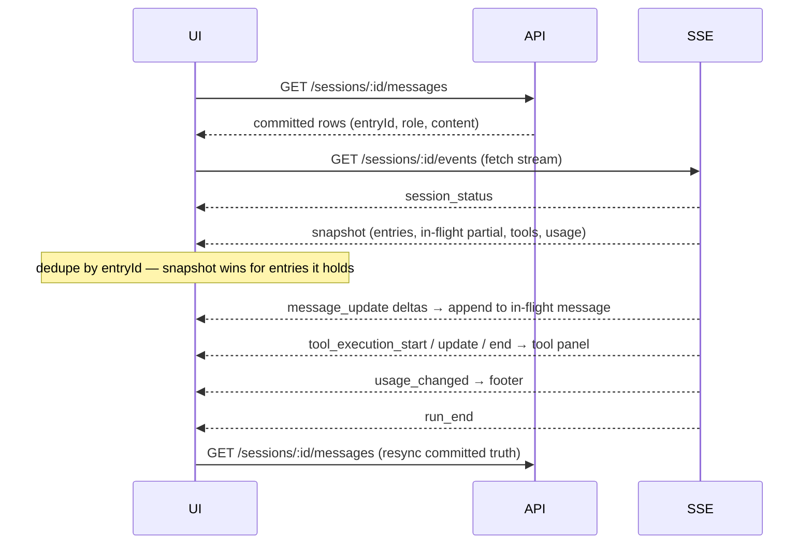
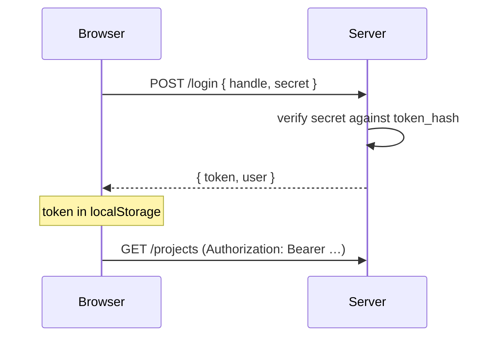

# Web Frontend — Implementation Plan

Implementation plan for a browser frontend over the session server, structured so a CLI and a mobile/PWA client can reuse the same typed contract later.

## Status

- **W0 complete** — Bun workspaces, `@nexus/client` with the wire contract, the HTTP client, and the SSE reader; the server's route handlers are annotated with the package's types.
- **W1 complete** — `POST /login` and `GET /me`, an explicit `auth: "none"` route discriminant, secrets with an underscore refused, and `NEXUS_WEB_DIR` serving with an `index.html` fallback.
- **W2 complete** — the Vite + React shell, login, the project list, and `401` clearing the stored token.
- **W3 complete** — project registration, detail with git state and a read-only file browser, and auth-method management with assignment.
- **W4 complete** — session create, list, restart, and delete with the `409` → force flow.
- **W5 complete** — the live conversation view: mirror transcript plus stream overlay, streaming text and tool output, usage, abort, reconnect, and a crashed session recovered from the UI.
- **W6 complete** — an accessibility pass measured on the rendering, narrow layouts, and a web manifest with icons.

180 tests pass; type checker and linter clean; the app builds.

Four bugs were found by verifying against a running system rather than by testing, and each is now pinned by a test: Bun closing idle event streams after ten seconds, a crashed session keeping its streams open forever, the abort button reading a polled status that lags a turn, and `fetch` called with the wrong receiver (which only a browser rejects).

## Context

The server (`docs/plans/pi-session-server.md`, complete) exposes a bearer-authenticated HTTP API and a per-session server-sent event stream. It has no browser-facing surface: no login route, no CORS headers, no static file serving. The frontend is a **test harness for the server** first and a product surface second, so it should exercise every route rather than a convenient subset.

Decisions taken with the user before planning:

| Question | Decision |
|---|---|
| Stack | React + Vite + TypeScript |
| Repo layout | Bun workspaces — `packages/client` + `apps/web` |
| Browser auth | Add a login endpoint to the server |
| First-version scope | Full admin (projects, auth methods, sessions) + live chat |

## Constraints Discovered

These are facts about the current server, each verified by reading the code, and each shapes the design.

| Constraint | Evidence | Consequence |
|---|---|---|
| `EventSource` cannot set an `Authorization` header | Web platform | The event stream must be read with `fetch` + `ReadableStream`, not `EventSource`. A hand-written frame parser is required — and it is testable in isolation. |
| No CORS headers, no `OPTIONS` handling | `src/server/app.ts`, `src/server/router.ts` have neither | Cross-origin calls from a dev server will fail. Avoid CORS entirely: proxy in dev, same origin in production. |
| No login route; the bearer token is printed once at boot | `src/server/main.ts` `ensureBootstrapUser` | The browser cannot obtain a token. A `POST /login` is required. |
| Auth is applied per matched route, with no opt-out | `route()` in `src/server/app.ts` calls `resolveUser` before every handler | `Route` needs an `auth: "none"` flag so `/login` can be exempt. |
| Only the **hash** of the secret is stored | `src/store/users.ts` — `token_hash`, `Bun.password.hash/verify` | `POST /login` cannot recover the token from storage; it verifies the supplied secret against the hash and **reconstructs** `<prefix>_<tokenId>_<secret>`. No schema change needed. |
| Token parsing requires exactly three `_`-separated parts | `authenticate()` in `src/store/users.ts` | A secret containing `_` silently breaks authentication. `NEXUS_BOOTSTRAP_TOKEN` is user-supplied, so this is reachable today. Hardening item in W1. |
| The transcript mirror and the live stream are two different sources | `GET /sessions/:id/messages` (mirror) vs the SSE `snapshot` | The UI must join them. `entryId` is the join key: mirror rows carry `entryId`, snapshot entries carry `id`. |

## Architecture

### Package layout

```
nexus/                          # root package: the server (unchanged location)
  src/                          # server
  packages/client/              # @nexus/client — the wire contract + HTTP/SSE client
  apps/web/                     # @nexus/web — the React app
  docs/
```

`package.json` gains `"workspaces": ["packages/*", "apps/*"]`. The server gains a `workspace:*` dependency on `@nexus/client`.

### One definition of the wire contract

`packages/client` owns the API shapes. The server **imports them** rather than defining a second copy:

- `packages/client/src/wire.ts` — request and response types for every route, plus the SSE frame union.
- `packages/client/src/client.ts` — `ApiClient`: one typed method per route, a bearer token, and a JSON error envelope reader.
- `packages/client/src/stream.ts` — `readEventStream`: a `fetch`-based SSE reader yielding typed frames, with reconnect and backoff.
- `packages/client/src/index.ts` — public surface.

The dependency direction (server → client package) is deliberate. The package holds the *contract*, not UI, so there is exactly one definition and drift fails `tsc` instead of surfacing as a runtime bug.

Event types come from Pi Durable as **type-only** imports (`import type { AgentEvent, SnapshotEvent } from "@earendil-works/pi-durable"`). The server forwards those events opaquely, so reusing the source types guarantees fidelity at zero runtime cost. Tradeoff: the client is pinned to the Pi Durable version the server uses. Accepted — it already is a repo dependency, and a hand-copied duplicate would drift silently.

### Rendering model: mirror is truth, stream is overlay

The core of the chat view. Compaction rewrites Pi Durable's own history but never the mirror, so the mirror is the only place the full transcript is guaranteed.



Rules that follow from it:

1. Render the mirror first, so the transcript is correct before any event arrives.
2. Overlay the snapshot, joining on `entryId`; the snapshot's `generation.message` is the in-flight partial.
3. Apply deltas (`message_update.changes`, `tool_execution_*`) to the overlay only.
4. On `run_end`, refetch the mirror and drop the overlay — the mirror is authoritative.
5. `409` from `/events` means no process is running. That is a **state**, not an error: show `stopped`/`crashed` with a restart action.

### Origin strategy: no CORS ever

| Environment | Frontend origin | API origin | Mechanism |
|---|---|---|---|
| Dev | `localhost:5173` (Vite) | `127.0.0.1:8787` | Vite `server.proxy` forwards `/api` → the server. Same-origin from the browser's view. |
| Production | server | same server | The server serves the built SPA from `NEXUS_WEB_DIR` with an SPA fallback. |

This keeps the server's auth model simple — no CORS allowlist, no cookies, no CSRF surface. The `Authorization` header works uniformly, including on the event stream, because both are read via `fetch`.

### Auth flow



`POST /login` and `GET /me` are the only unauthenticated/identity routes. A `401` anywhere clears the stored token and returns to the login screen.

## Server Changes Required

Small and bounded; each gets tests in the existing style.

1. **`Route` gains `auth?: "none"`** (`src/server/contract.ts`), honoured in `route()` (`src/server/app.ts`). Needed for `/login`.
2. **`POST /login`** — `{ handle, secret }` → `{ token, user }`, `401` on a bad handle or secret. Verifies against `token_hash` and reconstructs the token. New `src/server/routes/session-auth.ts`.
3. **`GET /me`** — the authenticated user, so the app can validate a stored token at startup.
4. **Secret validation** — reject a secret containing `_` at user creation, since `authenticate()` splits on it. Closes the sharp edge above.
5. **Static SPA serving** — when `NEXUS_WEB_DIR` is set, serve files from it and fall back to `index.html` for non-API paths. `NEXUS_WEB_DIR` added to `src/config.ts`.
6. **README** — document the new routes and the web app.

## Wire Contract Reference

The exact envelopes the client must type, read from the route handlers.

| Route | Response |
|---|---|
| `POST /login` *(new)* | `{ token, user }` |
| `GET /me` *(new)* | `{ user }` |
| `POST /projects` | `{ project }` · `201` |
| `GET /projects` | `{ projects }` |
| `GET /projects/:id` | `{ project }` |
| `GET /projects/:id/content?path=` | `{ content }` — `{ kind: "directory", path, entries: ContentEntry[] }` or `{ kind: "file", path, size, text }` |
| `GET /projects/:id/git/status` | `{ status: { branch, dirty: string[], ahead, behind } }` |
| `GET /projects/:id/git/log?limit=` | `{ commits: { sha, author, date, subject }[] }` |
| `GET /projects/:id/git/worktrees` | `{ worktrees: { path, branch, head, detached }[] }` |
| `PUT /projects/:id/auth-method` | `{ project }` |
| `POST /auth-methods` | `{ authMethod }` · `201` — metadata only, never the credential |
| `GET /auth-methods` | `{ authMethods }` |
| `DELETE /auth-methods/:id` | `{ deleted: true }` |
| `POST /projects/:id/sessions` | `{ session }` · `201` |
| `GET /projects/:id/sessions` | `{ sessions }` |
| `GET /sessions/:id` | `{ session }` |
| `POST /sessions/:id/messages` | `{ submissionId }` · `202` |
| `GET /sessions/:id/messages?limit=` | `{ messages: { sessionId, sequence, entryId, role, content, createdAt }[] }` — `content` is a JSON string |
| `POST /sessions/:id/abort` | `{ aborted: true }` |
| `POST /sessions/:id/restart` | `{ session }` |
| `DELETE /sessions/:id?force=` | `{ deleted: true, preservedBranch }` |
| `GET /sessions/:id/events` | SSE frames: `{ type: "session_status", status }`, `SnapshotEvent`, then `AgentEvent`s |

Errors are uniform: `{ error: { message } }` with `400`, `401`, `404`, `409`, `422`, or `500`.

## Milestones

Each milestone ends with a smoke run of the surface it changed. The web app is verified in a real browser, not only by tests.

### W0 — Workspace and contract

Root `package.json` gains workspaces; `packages/client` is created with `wire.ts`, `client.ts`, `stream.ts`. The server's route handlers annotate their returns with the package's types, and `src/types.ts` entity types are reused where the wire shape is identical. `tsconfig` and `biome` are widened to cover the new packages.

- Verify: `bun install` links the workspace; `bun run typecheck` and `bun run lint` are clean; the existing 117 tests still pass.
- Tests: the SSE frame parser — a frame split across reads, several frames in one read, a `\n\n`-terminated frame, and a partial trailing frame.

### W1 — Server: login and static serving

Items 1–6 above. `POST /login` verifies and reconstructs; `GET /me` returns the caller; secrets containing `_` are rejected; `NEXUS_WEB_DIR` serves the SPA with fallback.

- Verify: boot the server, `curl` a login with the bootstrap secret and get a working token; confirm `/login` needs no bearer and every other route still does; place an `index.html` in a directory and confirm `/some/spa/route` returns it while `/projects` still returns JSON.
- Tests: login success, wrong handle, wrong secret, missing fields; route auth exemption; SPA fallback not shadowing the API.

### W2 — Web shell and login

Vite + React + TypeScript in `apps/web`, Vite proxy to the API, an `ApiClient` instance backed by the token in `localStorage`, the login screen, an app shell (nav + project list), and uniform error handling that clears the token on `401`.

- Verify: in a browser, log in with the bootstrap secret, see the project list, reload and stay logged in, then log out.
- Tests: the token store (persist, clear, validate-on-boot).

### W3 — Admin: projects and auth methods

Register a project by path; project detail with git status, log, worktrees, and a read-only file browser; auth-method create (api_key and oauth), list, delete, and assignment to a project.

- Verify: register a real repository, see its branch and dirty files, create an API key, assign it, and confirm the assignment survives a reload. Confirm a traversal path (`../../etc/passwd`) is rejected in the UI, not just the API.
- Tests: form-level validation for the auth-method payloads, which are the only routes with a non-trivial request body.

### W4 — Sessions

Create a session (name, optional model and base ref), list per project, show status/pid/branch/worktree path, restart, and delete with the `409` → force flow.

- Verify: create two sessions on one project, see distinct branches and worktrees, confirm the main checkout stays clean, delete one with uncommitted work and see the refusal, then force it and see the branch preserved.
- Tests: the delete-conflict flow, which has two branches and is easy to get wrong.

### W5 — Live chat view

The milestone that justifies the project. Transcript from the mirror, snapshot overlay joined on `entryId`, streaming deltas, a tool-call panel with live output, usage, compaction markers, the prompt box with a stable `requestId` per submission, and abort. Reconnect with backoff, and `409` rendered as a session state rather than an error.

- Verify: prompt the `faux` provider and watch text stream in; kill the harness process with `SIGKILL` and watch the session become `crashed`, then restart and confirm the transcript is intact and the conversation resumes; run a session with a tiny context window and confirm a compaction marker appears while every original message remains.
- Tests: the transcript/overlay merge — dedupe by `entryId`, delta application, and the `run_end` resync. This is the piece most likely to be subtly wrong.

### W6 — Polish and PWA groundwork

Empty and error states, keyboard flow, responsive layout, an accessibility pass on contrast and focus, and a web manifest so the PWA path stays open.

- Verify: keyboard-only walkthrough of the login → project → session → prompt flow; a contrast check on the rendered pages.

## Risks

| Risk | Mitigation |
|---|---|
| The transcript/overlay merge drifts from the server's real event ordering | W5 tests pin dedupe and resync; the live smoke kills a harness mid-run, which is the ordering case most likely to break. |
| The client's types drift from the server | The server imports the package's types, so drift fails `tsc`. |
| Vite and Bun workspaces disagree on resolution | Resolved in W0, before any UI exists — cheapest possible moment to find it. |
| The mirror and Pi Durable's entries disagree on ids | Already handled server-side: the mirror stores Pi's `entryId`. W5's join is on that field. |
| Browser `fetch` streaming behaviour varies | Read the stream with `getReader()` and parse frames incrementally; the W0 parser tests cover split frames. |
| `localStorage` token is readable by any script on the origin | Accepted for a test harness. A cookie session is the documented upgrade path if this becomes a product. |

## Out of Scope

- **CLI and mobile/PWA clients.** This plan only makes them cheap: they consume `packages/client` unchanged. Neither is built here.
- **Multi-user registration.** The server has one bootstrap user. Login verifies that user; self-service signup is not added.
- **Rich text or markdown rendering of messages.** Plain text first; formatting is a later decision.
- **Editing project content.** The content API is read-only by design and the UI stays read-only.
- **WebSocket transport.** SSE already covers the server → client direction; the client → server direction is plain HTTP.

## Documentation

- `docs/INDEX.md` — add this plan.
- `README.md` — the new routes (`/login`, `/me`), `NEXUS_WEB_DIR`, and how to run the web app in dev and production.
